# ORION N5 // D350 — Omarchy Linux Theme

> **Industrial aerospace telemetry & Mars logistics hardware aesthetic** for [Omarchy Linux](https://omarchy.org/) — matte anodized carbon chassis (`#141615`), oxidized sage-mint instrumentation (`#9ecab3` / `#c4ddd0`), aerospace safety orange alerts (`#ff5a1f`), sharp beveled geometry, and a full suite of 3D, vector, and animated wallpapers.

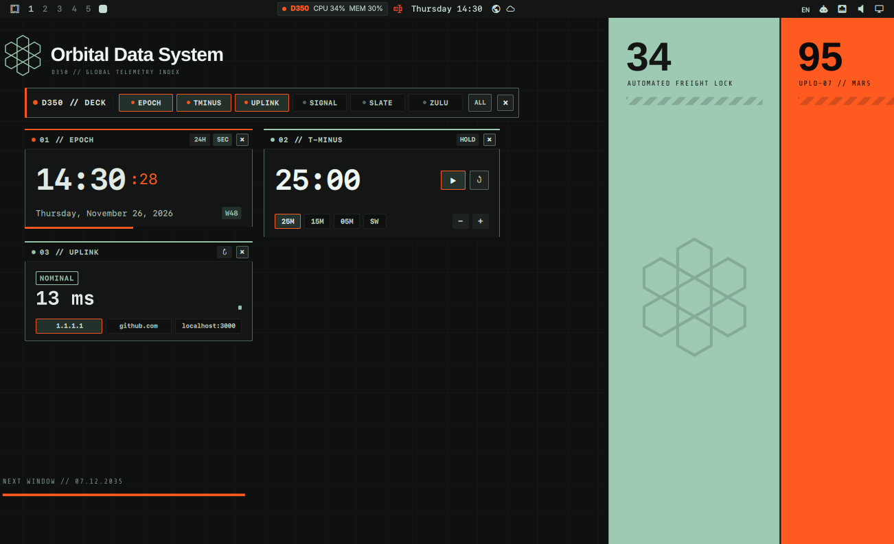

---

## Summary of Included Modules

| Layer | What's Included |
| :--- | :--- |
| **Desktop & Compositor** | `colors.toml`, sharp industrial `hyprland.lua` (`rounding = 2`, `border_size = 2`, 45° orange-to-sage active border), low-intensity cool sage-mint CRT shader (`crt-scanlines-orion-n5.glsl`) |
| **Orion Deck (`deck`)** | Single-icon unified desktop telemetry widget pack (`assets/deck/`) with a frameless top control bar (`D350 // DECK`) toggling 6 independent draggable cards: **`EPOCH`** (clock/date/week), **`T-MINUS`** (countdown/Pomodoro/stopwatch), **`UPLINK`** (latency beacon + sparkline), **`SIGNAL`** (MPRIS Now Playing), **`SLATE`** (auto-save scratchpad), and **`ZULU`** (multi-zone mission clock) |
| **Omarchy Shell & Bar** | Custom `shell.toml`, 7-hex menu emblem (`assets/orion-n5-bar-logo.svg`), and custom `orion.telemetry` Quickshell bar pill + floating **Mission Control** `PopupCard` (live CPU, RAM, Disk, Uptime, btop launcher) |
| **Terminals & Shell** | Auto-themed Alacritty, Foot, Ghostty, Kitty; custom **Orbital Data System** bash header (`assets/orion-n5-banner.sh`); Swiss-industrial Starship prompt (`assets/starship-orion-n5.toml`); `tmux` telemetry status bar; `lazygit` single-border theme; `btop` braille tuning |
| **Neovim** | Bundled `neovim.lua` (`omacom/aether.nvim` v3) with a custom **Orion N5 // D350** Snacks dashboard, sharp single-line borders (`D350 // KEYMAP MATRIX`), and theme-aware `N5:` Lualine status bar |
| **About & Screensaver** | High-contrast Sixel **Terminal Specification** card (`assets/orion-n5-about-card.png`) + restyled Fastfetch telemetry sections (`assets/fastfetch-orion-n5.jsonc`), plus `ORION N5 // D350` standby screensaver |
| **Icons, Cursors & Sound** | Custom hardware-key SVG app icon pack (`Orion-N5`), native Xcursor technical reticle theme (`Orion-N5-Cursor`), and synthesized mechanical telemetry sound pack (`assets/sounds/*.wav`) |
| **Boot, Login & Restart** | Complete **Plymouth** theme (`plymouth/`) with distinct Boot, Reboot, and Shutdown telemetry modes, **SDDM** login theme (`sddm/`), lock screen `unlock.png`, and `install-boot-login.sh` |
| **Browser Startpage** | Self-contained local HTML/CSS/SVG **Orbital Data System** dashboard (`startpage/index.html`) |
| **Wallpapers** | 1 seamless looping **animated MP4** default wallpaper + **8 static 4K/3D** wallpapers (`backgrounds/`) |

---

## Color Scheme

| Role | Token | Hex | Swatch |
| :--- | :--- | :--- | :--- |
| **Deep Shadow** | `darker_background` | `#0a0b0a` |  |
| **Recessed Frame** | `dark_background` | `#0f1110` |  |
| **Carbon Chassis (Base)** | `background` | `#141615` |  |
| **Elevated Panel** | `lighter_background` | `#1e2220` |  |
| **Selection Slate** | `selection` | `#25332c` |  |
| **Muted Grid / Comments** | `muted` | `#54685e` |  |
| **Secondary Sage** | `dark_foreground` | `#7d9689` |  |
| **Primary Sage-Mint** | `foreground` | `#c4ddd0` |  |
| **Telemetry White-Mint** | `bright_foreground` | `#eef7f2` |  |
| **Aerospace Safety Orange** | `accent` / `orange` | `#ff5a1f` |  |
| **Critical Alert Red** | `red` | `#ff4526` |  |
| **Telemetry Amber** | `yellow` | `#e5a93c` |  |
| **Signature Matte Mint** | `green` | `#9ecab3` |  |
| **Orbital Teal** | `cyan` | `#7db5a3` |  |
| **Steel Slate-Teal** | `blue` | `#6e9896` |  |
| **Burnt Terracotta** | `magenta` | `#d96b43` |  |

---

## Themed System Screens & Assets

### About Window Specification Card (Sixel / Fastfetch)
<p align="center">
  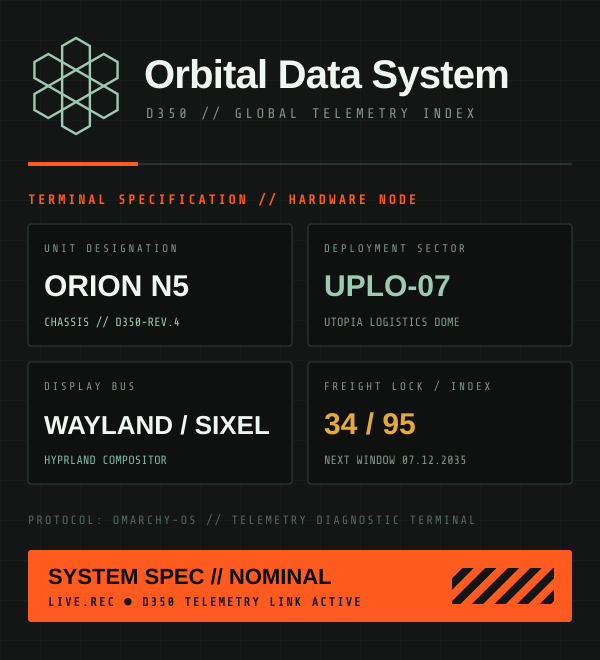
</p>

### Bootsplash, SDDM Login, Reboot & Shutdown Screens

| Bootsplash (Plymouth Boot) | Login Screen (SDDM) |
| :---: | :---: |
|  | 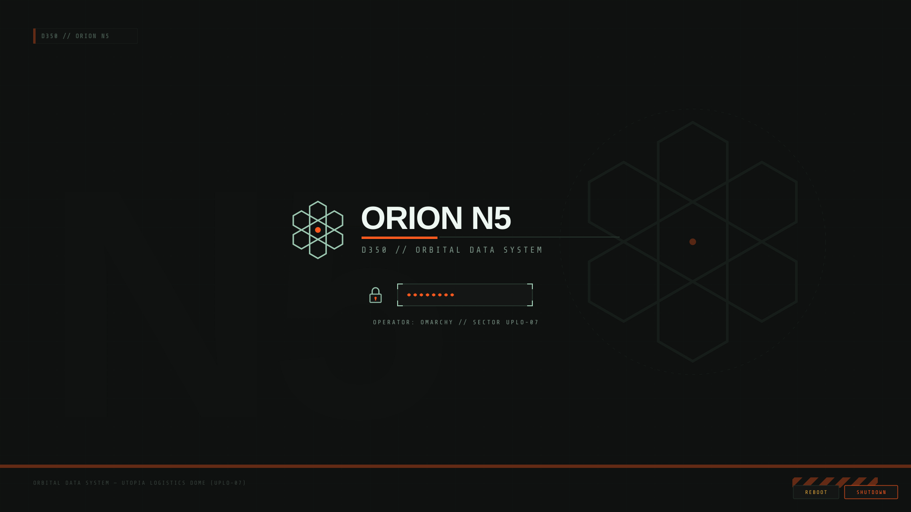 |
| **Reboot Screen (Plymouth Reboot)** | **Shutdown Screen (Plymouth Shutdown)** |
| 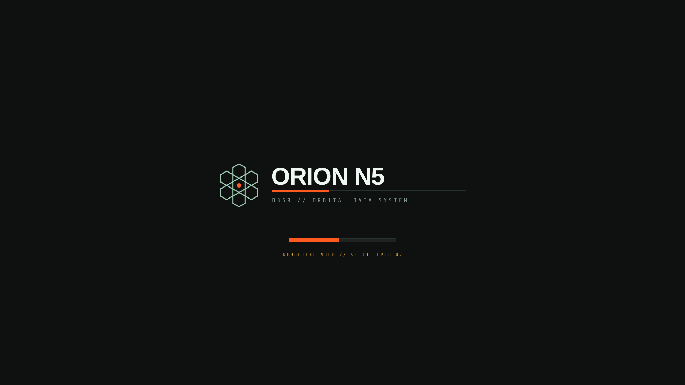 | 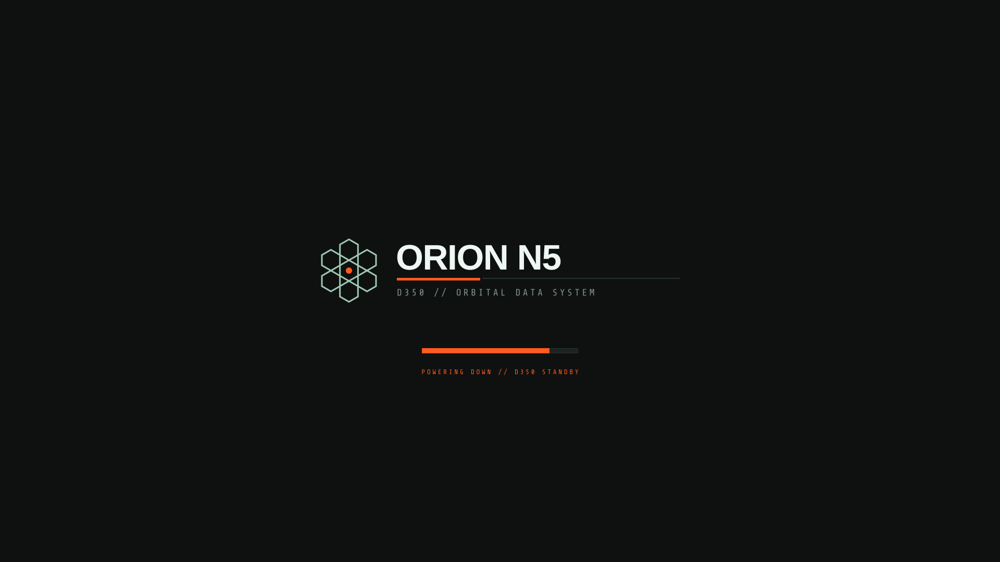 |

---

## Wallpaper Gallery

### Default Animated Wallpaper (`00-orion-n5-orbital-live.mp4`)
*Seamless 10-second 1080p @ 30fps rotating orbital radar loop — loads automatically via Omarchy's `owe` wallpaper engine.*

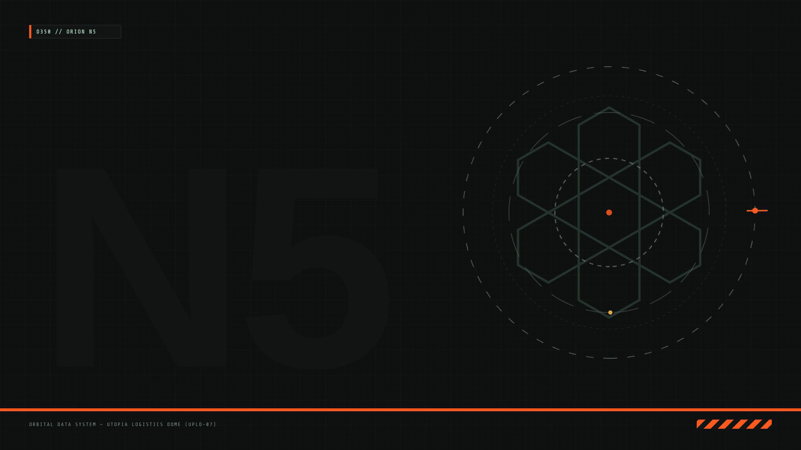

### Static 4K & 3D Industrial Wallpapers

| `01` Dark Carbon Grid | `02` Telemetry Split-Panel |
| :---: | :---: |
| 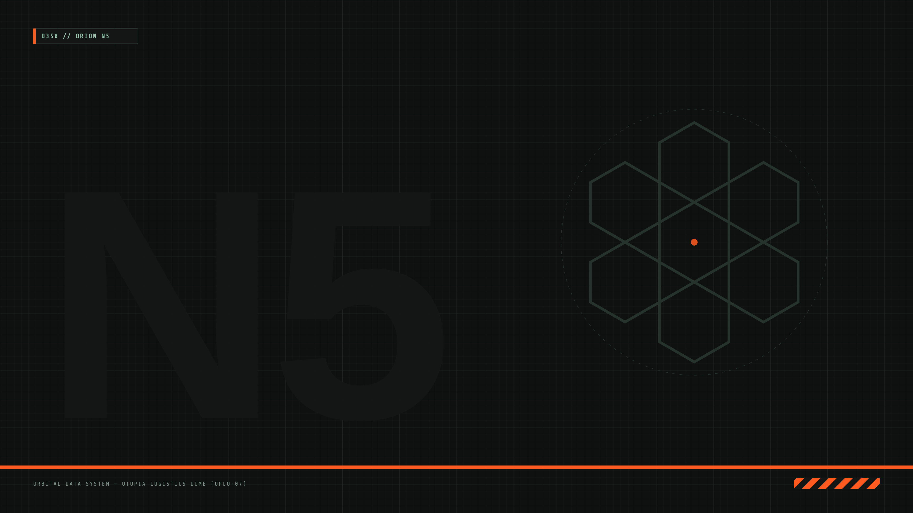 | 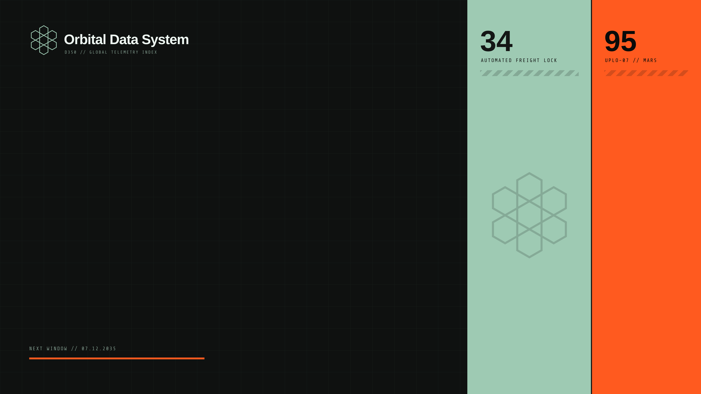 |
| **`03` Minimal Centered Emblem** | **`04` D350 Quadruped Mech (3D)** |
| 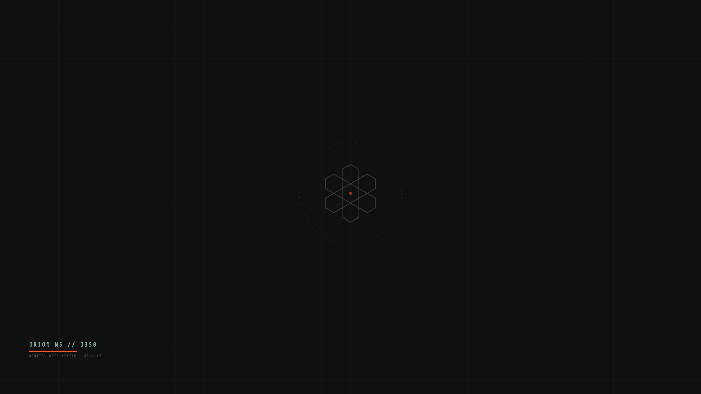 | 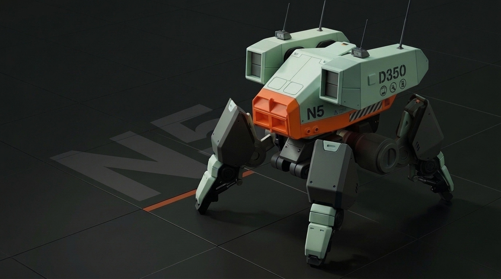 |
| **`05` Orbital Data Map** | **`06` Lunar-04 Transport Rover (3D)** |
| 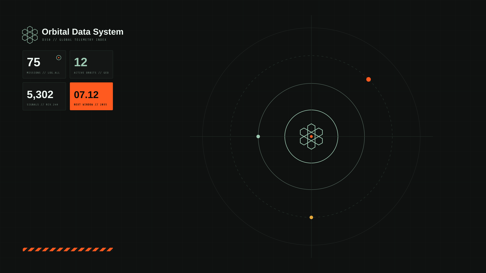 | 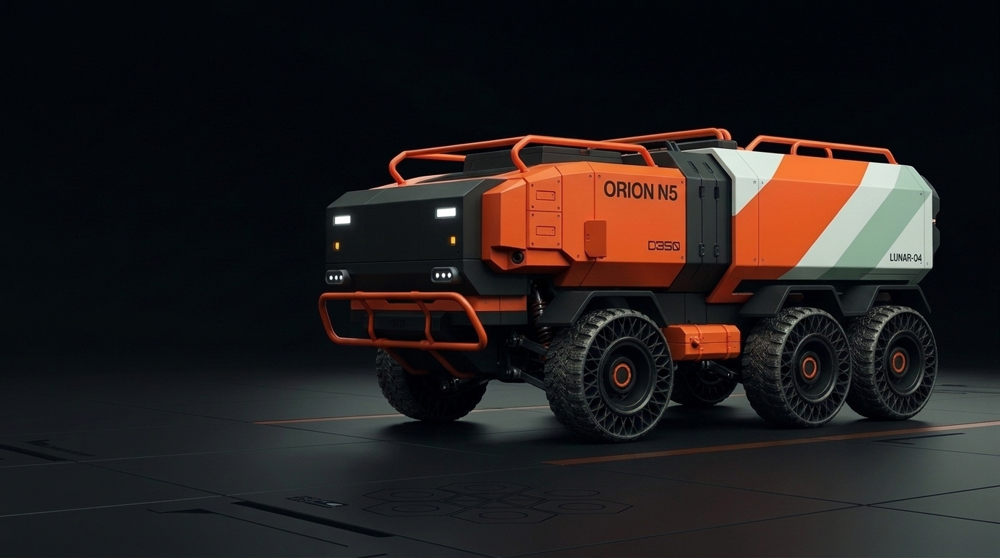 |
| **`07` Utopia Logistics Dome — Mars Habitat (3D)** | **`08` MK-IV Battle Mech Blueprint** |
| 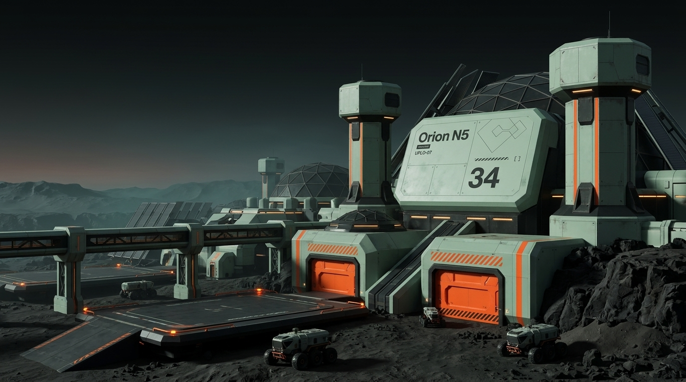 | 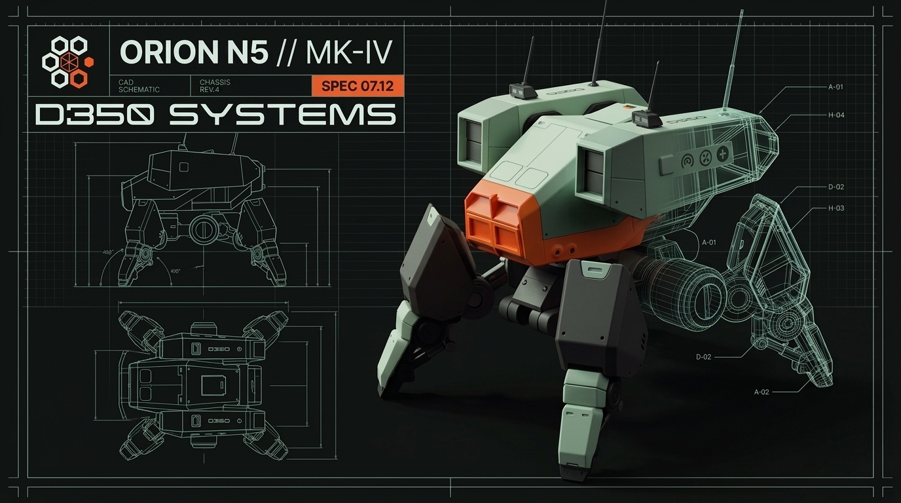 |

---

## Installation

### One-Command Full-Set Install
```bash
git clone https://github.com/Xkalin1990/orion-n5-omarchy-theme.git ~/Work/orion-n5-theme
cd ~/Work/orion-n5-theme
./install.sh              # Full user-space suite (theme, icons, cursor, bar plugin, hooks, Neovim, Starship, tmux, lazygit)
./install.sh --with-boot  # Full suite + Plymouth bootsplash, SDDM login theme, and owe animated wallpaper engine
```

> **100% Theme-Aware & Reversible**: `install.sh` installs `~/.config/omarchy/hooks/theme-set.d/orion-n5-sync.sh`, which automatically backs up your previous configs (`Fastfetch`, `Starship`, `Screensaver`, `lazygit`, `btop`, `tmux`, `Cursor`, `Quickshell bar widget`, and `Bar menu logo`). Switching away from `orion-n5` to any other Omarchy theme cleanly restores everything with zero Orion N5 leftovers — and switching back to `orion-n5` re-enables every feature automatically.

### Optional: Chromium Orbital Startpage
Open `file:///home/omarchy/Work/orion-n5-theme/startpage/index.html` in Chromium or set it as your default startup/new-tab page.
